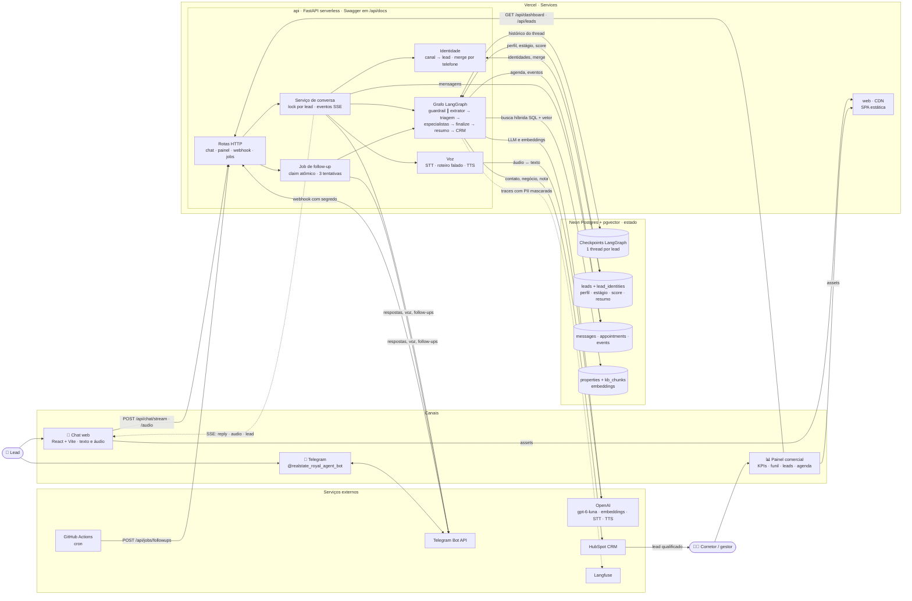
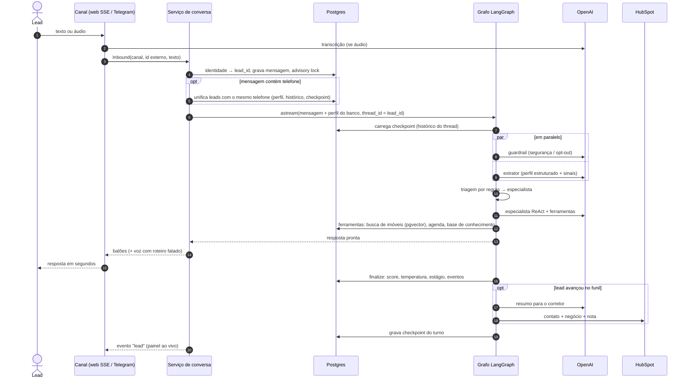
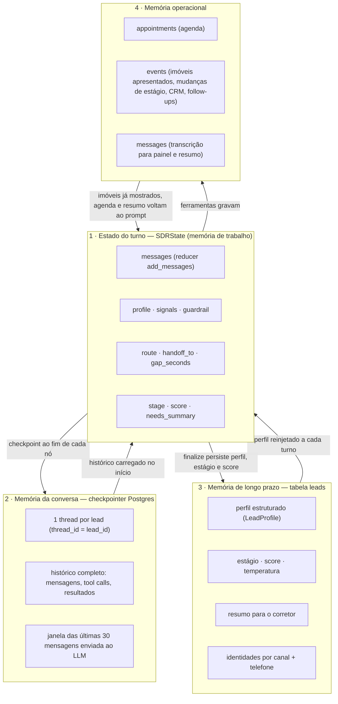
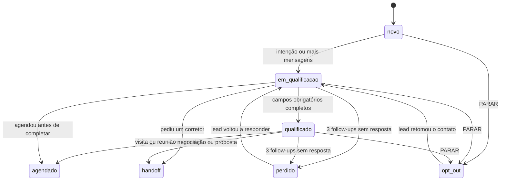
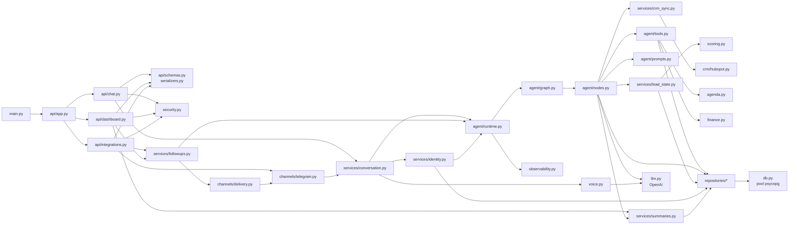
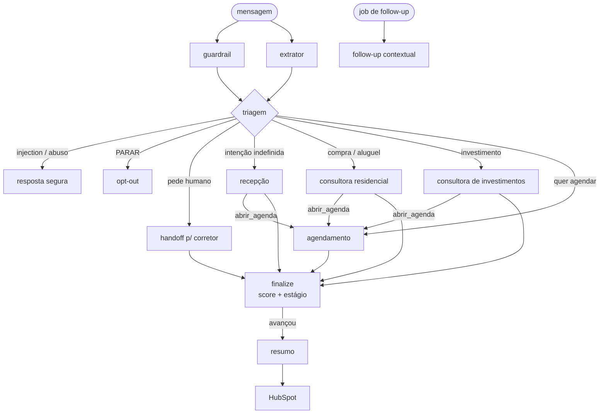

# Royal SDR — Agente SDR Imobiliário com IA

POC do Hackathon FIAP (Tech Challenge Fase 5): um agente de IA que atende leads de uma imobiliária 24/7, conversa de forma humanizada, qualifica (compra, aluguel ou investimento), apresenta imóveis de uma base simulada, agenda visitas, faz follow-up automático e entrega ao corretor um resumo pronto — com painel de acompanhamento, integração com Telegram, voz e CRM (HubSpot).

A persona é a **Sofia**, consultora virtual da fictícia **Royal Imóveis**, que atua em **Tatuí e região (interior de SP)**. O portfólio é **real**: 71 imóveis importados do site da corretora parceira do beta, com fotos, descrições e localização.

- **Chat web + Visão do agente**: o lead conversa (texto ou áudio) e um painel lateral mostra, ao vivo, o que a IA entendeu: intenção, perfil, score, estágio e o que ainda falta descobrir.
- **Telegram**: o mesmo agente atende em `t.me/realstate_royal_agent_bot`, inclusive mensagens de voz.
- **Painel comercial**: funil, temperatura dos leads, tempo de resposta, follow-ups, agenda e o resumo de cada lead para o corretor.

## Requisitos do desafio → solução

| Requisito | Como foi atendido | Onde |
|---|---|---|
| Atendimento conversacional, conversa natural, fluxo humanizado | Persona de vendedora consultiva e assertiva: conduz a conversa, recomenda com opinião, simula parcelas por conta própria, oferece horários concretos e contorna objeções; mensagens curtas em balões, "digitando…" | `backend/sdr/agent/prompts.py`, `web/src/components/chat` |
| Continuidade da conversa / memória conversacional | Checkpointer Postgres do LangGraph por lead + perfil estruturado persistido e reinjetado a cada turno + resumo da conversa, imóveis já apresentados e reconhecimento de quem volta; identidade unificada entre web e Telegram pelo telefone | `sdr/agent/runtime.py`, `sdr/services/identity.py` |
| Qualificação de leads | Extrator com *structured output* + score determinístico 0–100 (quente/morno/frio) + estágios do funil | `sdr/agent/nodes.py::extract`, `sdr/scoring.py` |
| Identificar compra, aluguel ou investimento | Campo `intent` extraído e roteamento para o especialista certo | `sdr/agent/nodes.py::decide_route` |
| Coletar informações relevantes | Perfil com faixa de preço, quartos, região, urgência, pagamento, ticket, retorno esperado, pet, objeções… | `sdr/models.py::LeadProfile` |
| Follow-up automático | Job idempotente com 3 tentativas e estratégias diferentes, mantendo o contexto; sem resposta → lead "perdido" | `sdr/services/followups.py`, `.github/workflows/followups.yml` |
| Agendamento de reuniões ou visitas | Agente de agendamento com agenda dos corretores (horário comercial, sem conflito, remarcação) | `sdr/agenda.py`, `sdr/agent/tools.py` |
| Integração com base de imóveis | 71 imóveis reais de Tatuí e região importados do site parceiro (`scripts/import_imobibrasil.py`): fotos, descrição, endereço, coordenadas, taxas. Busca híbrida SQL + pgvector por bairro, condomínio e cidade, com relaxamento transparente de filtros | `backend/data/catalogs/`, `sdr/repositories/properties.py` |
| Resumo inteligente para corretores | Resumo estruturado (perfil, necessidades, imóveis, objeções, próximos passos, dica de abordagem) | `sdr/services/summaries.py` |
| Dashboard mínimo | Painel com KPIs, funil, temperatura, intenção, leads por dia, agenda, detalhe do lead | `web/src/pages` |

| Diferencial | Status |
|---|---|
| RAG | ✅ imóveis (filtros + embeddings) e base de conhecimento (financiamento, ITBI, locação, investimento) |
| Integração com WhatsApp | ➖ substituído por **Telegram** (gratuito, mesma arquitetura de canal por webhook), com álbum de fotos dos imóveis e botão de compartilhar contato |
| Memória conversacional | ✅ checkpointer Postgres + perfil de longo prazo |
| Multiagentes | ✅ supervisor determinístico + 4 especialistas ReAct + transferência entre agentes (`abrir_agenda`) |
| Voice AI | ✅ transcrição de áudio e resposta em voz (web e Telegram) com roteiro reescrito para fala e voz `marin` |
| Integração com CRM | ✅ HubSpot (contato + negócio + nota com resumo) |
| Observabilidade | ✅ Langfuse (traces por sessão), logs JSON com PII mascarada, latência por resposta |
| Segurança | ✅ guardrail contra prompt injection, opt-out, LGPD, rate limit, tokens para painel/cron/webhook |
| Deploy em cloud | ✅ Vercel (Services: Vite + FastAPI) + Neon Postgres, custo zero de infraestrutura |

## Arquitetura

### Visão geral da solução

Tudo roda em um único deploy na Vercel (Services): o frontend estático e a API FastAPI como função serverless. Todo o estado fica no Postgres (Neon). As setas mostram quem chama quem e qual informação trafega.



### Fluxo de informação de uma mensagem



### Gerenciamento de estado

O estado vive em quatro camadas. O banco é a fonte da verdade; o checkpoint guarda a conversa; o estado do grafo só existe durante o turno.



Ciclo de vida do lead (estágios do funil calculados pelo nó `finalize`):



### Dependências entre módulos do backend



| Camada | Responsabilidade | Depende de |
|---|---|---|
| `api/` | Contrato HTTP, validação, autenticação, documentação OpenAPI | `services/`, `security.py` |
| `services/` | Casos de uso: conversa, identidade, follow-up, resumo, CRM | `agent/`, `repositories/`, `channels/` |
| `agent/` | Grafo, nós, prompts e ferramentas do LangGraph | `repositories/`, `llm.py`, regras de domínio |
| Regras de domínio | `scoring.py`, `agenda.py`, `finance.py`: funções puras e testadas | — |
| `repositories/` | SQL explícito por agregado | `db.py` |
| Adaptadores | `channels/` (Telegram), `crm/` (HubSpot), `voice.py`, `llm.py`, `observability.py` | APIs externas |

O núcleo do agente é um grafo LangGraph. A cada mensagem:
- o **guardrail** e o **extrator** rodam em paralelo;
- a **triagem** (por regras, não pelo LLM) escolhe o especialista;
- o especialista conversa usando ferramentas e pode transferir a conversa para a agenda (`abrir_agenda`) no mesmo turno;
- o **finalize** recalcula score e estágio;
- quando o lead avança, o grafo gera o **resumo** e sincroniza o **CRM**.



### Documentação da API

A API é documentada com OpenAPI 3.1:
- **Swagger UI:** `/api/docs`, com botão *Authorize* para os esquemas `TokenPainel`, `CronSecret` e `TelegramWebhookSecret`.
- **ReDoc:** `/api/redoc`.
- **Especificação:** `/api/openapi.json`.

Todas as rotas têm descrição, exemplos em pt-BR e modelos de resposta, inclusive os eventos SSE do chat.

Detalhes em [docs/arquitetura.md](docs/arquitetura.md) e a explicação da IA em [docs/ia.md](docs/ia.md). O roteiro do pitch e da demo está em [docs/pitch.md](docs/pitch.md).

## Stack

- **Backend**: Python 3.12, FastAPI, LangGraph 1.2, LangChain 1.4 (`create_agent`), Pydantic v2, psycopg 3, uv
- **IA**: OpenAI `gpt-6-luna` (conversa e tarefas rápidas), `text-embedding-3-small`, `gpt-4o-mini-transcribe`, `gpt-4o-mini-tts`
- **Dados**: PostgreSQL + pgvector (Neon em produção, Docker localmente), checkpointer `langgraph-checkpoint-postgres`
- **Frontend**: React 19, Vite 8, TypeScript, Tailwind 4, componentes no estilo shadcn/ui, TanStack Query, Recharts, Mermaid
- **Integrações**: Telegram Bot API, HubSpot CRM API, Langfuse
- **Infra**: Vercel (Services), Neon, GitHub Actions (CI e cron de follow-up)

## Rodando localmente

Pré-requisitos: Docker e uma chave da OpenAI.

```bash
cp .env.example .env        # preencha OPENAI_API_KEY (Telegram, HubSpot e Langfuse são opcionais)
docker compose up --build
```

Isso sobe Postgres com pgvector, aplica o schema, carrega imóveis e base de conhecimento (com embeddings), e inicia API (`:8000`), frontend (`:5173`) e um agendador que dispara o follow-up a cada minuto.

- Chat: http://localhost:5173
- Painel: http://localhost:5173/painel (token padrão `royal-demo`)
- API docs: http://localhost:8000/api/docs

Para atender pelo Telegram localmente (sem URL pública), suba também o worker de polling: `docker compose --profile telegram up`.

### Sem Docker (desenvolvimento)

```bash
docker compose up -d db
cd backend
uv sync
uv run python -m scripts.migrate && uv run python -m scripts.seed
uv run uvicorn main:app --reload --port 8000

cd ../web
npm ci && npm run dev
```

Ferramentas úteis no backend:

| Comando | O que faz |
|---|---|
| `uv run python -m scripts.chat_cli -v` | Conversa com o agente pelo terminal mostrando perfil, score e especialista |
| `uv run python -m scripts.run_followups --force` | Roda uma rodada de follow-ups ignorando o intervalo (demo) |
| `uv run python -m scripts.telegram_polling` | Atende o bot do Telegram via long polling |
| `uv run python -m scripts.set_telegram_webhook https://seu-app.vercel.app` | Aponta o bot para o webhook em produção |
| `uv run python -m scripts.import_imobibrasil https://www.sua-imobiliaria.com.br --nome parceiro` | Importa o catálogo de um site ImobiBrasil: imóveis, fotos, descrições, endereço, coordenadas e páginas institucionais (`data/catalogs/<nome>/`, fora do git) |
| `uv run python -m scripts.generate_properties` | Gera o catálogo sintético de SP usado na primeira versão (legado, não é carregado) |
| `uv run python -m scripts.seed --force` | Recarrega imóveis e base de conhecimento com embeddings |
| `uv run python -m evals.run_scenarios` | Avalia os 3 cenários do desafio com lead simulado e LLM-juiz |

## Variáveis de ambiente

| Variável | Obrigatória | Descrição |
|---|---|---|
| `OPENAI_API_KEY` | sim | LLM, embeddings, transcrição e voz |
| `CHAT_MODEL` / `FAST_MODEL` | não | Modelos dos especialistas e das tarefas rápidas (padrão `gpt-6-luna`) |
| `CHAT_REASONING_EFFORT` / `FAST_REASONING_EFFORT` | não | Esforço de raciocínio (`low` / `none`) |
| `DATABASE_URL` | sim | Postgres com pgvector. Na Vercel, a integração Neon injeta `DATABASE_URL` e `DATABASE_URL_UNPOOLED` (usada com prioridade) |
| `DASHBOARD_TOKEN` | sim | Token de acesso ao painel |
| `CRON_SECRET` | sim | Protege `/api/jobs/followups` |
| `CORS_ORIGINS` | não | Origens permitidas fora do mesmo domínio |
| `FOLLOWUP_DELAYS` | não | Intervalos entre tentativas de follow-up (padrão `20m,1d,3d`; para demo, ex.: `1m,2m,3m`) |
| `CATALOG` | não | Pasta do catálogo em `backend/data/catalogs/` carregado pelo seed (padrão `parceiro`) |
| `COMPANY_NAME` / `COMPANY_REGION` | não | Marca e região de atuação usadas pela persona (padrão `Royal Imóveis` / `Tatuí e região…`) |
| `TTS_VOICE` | não | Voz da resposta em áudio (padrão `marin`) |
| `FOLLOWUP_LOST_AFTER` | não | Tempo após a última tentativa para marcar o lead como perdido (padrão `2d`) |
| `TELEGRAM_BOT_TOKEN` / `TELEGRAM_WEBHOOK_SECRET` | não | Bot do Telegram e segredo validado no header do webhook |
| `HUBSPOT_TOKEN` / `HUBSPOT_PORTAL_ID` | não | Token de app privado (`pat-…`) e Hub ID para links no painel |
| `LANGFUSE_PUBLIC_KEY` / `LANGFUSE_SECRET_KEY` / `LANGFUSE_BASE_URL` | não | Tracing das execuções |

## Integrações

**Telegram** — crie o bot no [@BotFather](https://t.me/BotFather) e defina `TELEGRAM_BOT_TOKEN` e um `TELEGRAM_WEBHOOK_SECRET` aleatório. Em produção, rode `scripts.set_telegram_webhook` com a URL pública; localmente, use o polling. O bot entende texto e áudio, e responde áudio com áudio.

**HubSpot (plano gratuito)** — em *Development → Legacy apps → Create legacy app → Private*, adicione os escopos `crm.objects.contacts.read/write` e `crm.objects.deals.read/write`, copie o token da aba *Auth* para `HUBSPOT_TOKEN` e o Hub ID para `HUBSPOT_PORTAL_ID`. Quando um lead fica qualificado, agendado ou é encaminhado, o agente cria/atualiza contato e negócio e anexa uma nota com o resumo.

**Langfuse (Hobby gratuito)** — crie um projeto em cloud.langfuse.com e defina as chaves. Cada conversa vira uma sessão com o trace completo do grafo (nós, ferramentas, tokens, latência), com dados pessoais mascarados.

## Deploy (Vercel + Neon, custo zero)

1. Suba o repositório para o GitHub e importe na Vercel. O `vercel.json` usa **Services**: `web/` (Vite) e `backend/` (FastAPI), com `/api/*` roteado para o Python.
2. Em *Storage*, adicione **Neon Postgres** pelo Marketplace (plano free). As variáveis `DATABASE_URL*` são injetadas automaticamente.
3. Cadastre as variáveis de ambiente (`OPENAI_API_KEY`, `DASHBOARD_TOKEN`, `CRON_SECRET` e as opcionais).
4. Faça o deploy. O build do backend (`scripts/vercel_build.py`) aplica o schema, cria o checkpointer e carrega a base de conhecimento. O catálogo de imóveis da imobiliária parceira **não é versionado** (`backend/data/catalogs/` fica fora do git): carregue-o no Neon uma vez a partir da sua máquina, com `DATABASE_URL=<url do Neon> uv run python -m scripts.seed`, ou importe de novo com `scripts.import_imobibrasil` antes do seed.
5. Telegram: `uv run python -m scripts.set_telegram_webhook https://<seu-app>.vercel.app`.
6. Follow-up: no GitHub, crie a variável `APP_URL` e o segredo `CRON_SECRET`. O workflow `followups.yml` chama o job a cada 30 minutos (o cron da Vercel no plano Hobby só roda uma vez por dia). O painel também tem o botão "Rodar follow-ups".

## Testes e avaliação

```bash
cd backend
uv run pytest            # regras de negócio: score, estágios, roteamento, agenda, finanças, PII
uv run ruff check . && uv run ruff format --check .
uv run python -m evals.run_scenarios   # cenários do PDF com LLM real (gera relatório em evals/reports)
```

A avaliação de cenários simula o lead com um LLM seguindo uma persona (casa em condomínio em Tatuí, investidor, comprador do Minha Casa Minha Vida que some) e usa um LLM-juiz para verificar o checklist do desafio (perguntou faixa de preço? identificou urgência? encaminhou para reunião?) e dar notas de humanização, contexto e objetividade.

## Estrutura

```
backend/
  main.py                  entrada ASGI (Vercel/uvicorn)
  sdr/
    agent/                 grafo LangGraph: estado, nós, prompts, ferramentas, runtime
    api/                   rotas FastAPI (chat SSE, painel, integrações)
    channels/              Telegram e entrega de mensagens
    crm/                   porta de CRM + adaptador HubSpot
    repositories/          acesso a dados (SQL puro com psycopg)
    services/              conversa, follow-up, resumo, sincronização com CRM
    agenda.py scoring.py finance.py voice.py security.py observability.py
  data/                    catálogos importados (catalogs/), base de conhecimento (kb/) e catálogo sintético legado
  scripts/                 migração, seed, CLI, Telegram, follow-up, build da Vercel
  evals/                   avaliação dos cenários com LLM-juiz
  tests/
web/                       React + Vite (chat, painel, agenda, imóveis, como funciona)
docs/                      arquitetura, explicação da IA e roteiro do pitch
```

## Decisões e limitações

- **Roteamento determinístico** em vez de deixar o LLM escolher o especialista: previsível, testável e barato. O LLM decide *o que dizer*, as regras decidem *quem fala*.
- **Uma única chave de IA (OpenAI)** e infraestrutura gratuita (Vercel Hobby, Neon free, Langfuse Hobby, HubSpot Free, Telegram).
- **Serverless**: não há processo residente, por isso o follow-up é um endpoint idempotente disparado por cron externo; concorrência por lead é controlada com *advisory lock* no Postgres.
- **WhatsApp** ficou de fora por custo e burocracia (Meta Business); o canal é um adaptador, então plugar a WhatsApp Cloud API segue o mesmo padrão do Telegram.
- A agenda dos corretores é simulada (horário comercial, conflitos e remarcação reais, sem calendário externo).
- O portfólio é real (importado do site parceiro), mas a marca e a equipe são fictícias; os aluguéis estimados para o cálculo de rentabilidade usam 0,45% ao mês como referência.
- As fotos ficam no CDN do site de origem (URLs no banco); o download local (`data/catalogs/*/fotos`, ~112 MB) é só backup e fica fora do git e do bundle da Vercel.
- Identidade entre canais é unificada pelo telefone: o lead que conversou no site e depois passa o mesmo número no Telegram vira um só, com histórico, perfil e checkpoint mesclados.
- Números de financiamento e rentabilidade são estimativas e o agente sempre informa isso.
