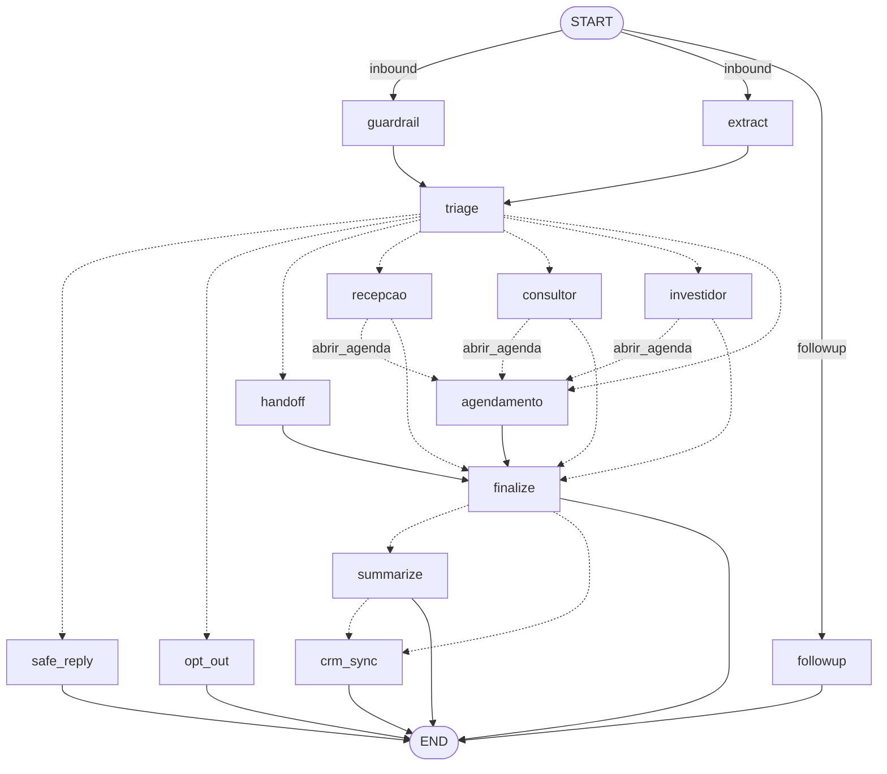
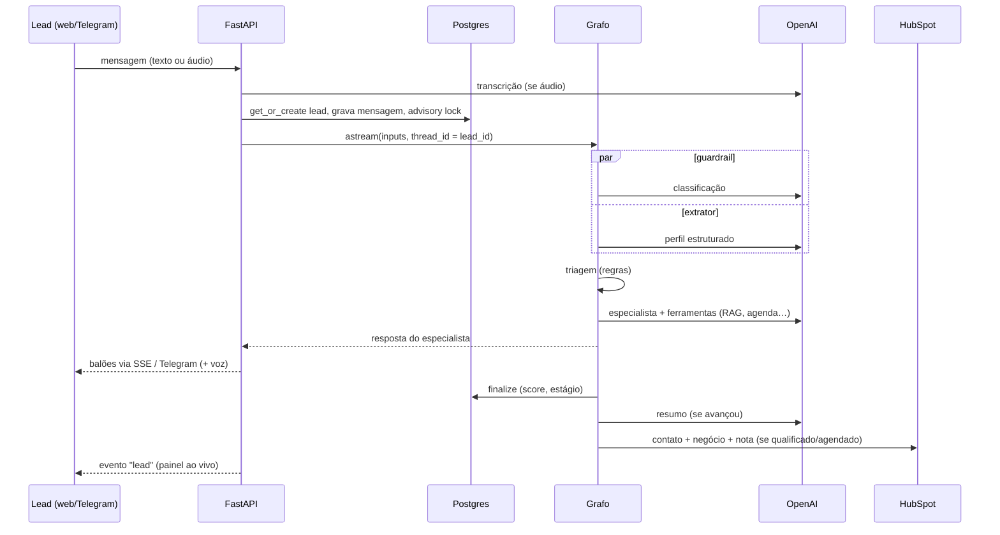
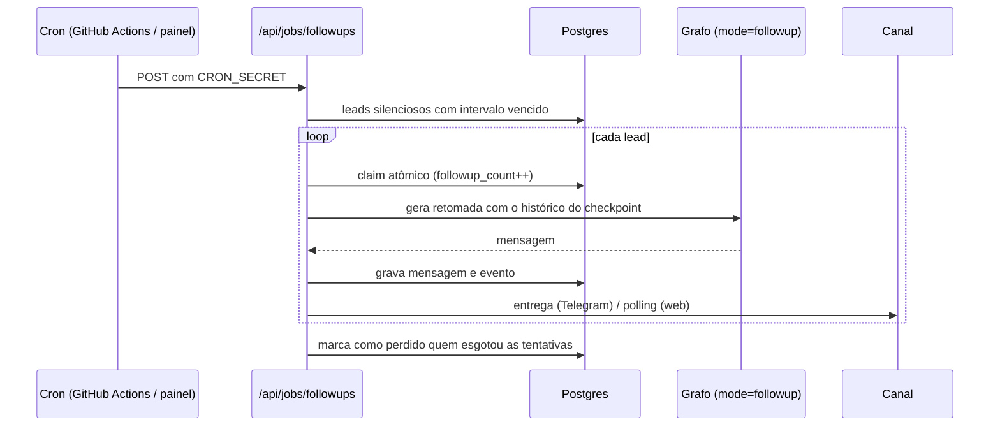
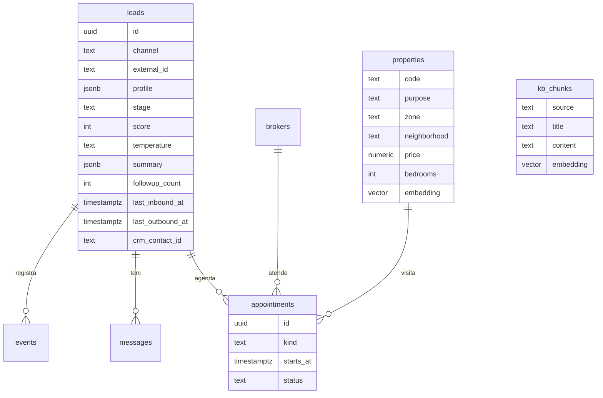

# Arquitetura da solução

## Visão geral

A solução tem três camadas, todas no mesmo repositório e no mesmo deploy:

1. **Canais**: chat web (React) e Telegram. Ambos entram pelo mesmo serviço de conversa; o canal é só um adaptador de entrada e saída.
2. **API + agente**: FastAPI rodando como Vercel Function. O serviço de conversa serializa os turnos de cada lead e executa o grafo LangGraph.
3. **Dados**: um único Postgres (Neon) com pgvector guarda checkpoints do LangGraph, leads, mensagens, agenda, eventos e os embeddings de imóveis e da base de conhecimento.

Todas as dependências externas são gratuitas, exceto a API da OpenAI (custo de centavos por dezenas de conversas com `gpt-6-luna`).

## Componentes

| Componente | Responsabilidade | Código |
|---|---|---|
| Serviço de conversa | Cria/recupera o lead, grava a mensagem, adquire *advisory lock* por lead, executa o grafo em streaming e emite eventos (`reply`, `audio`, `notice`, `lead`) | `sdr/services/conversation.py` |
| Grafo do agente | Guardrail, extração, triagem, especialistas, finalize, resumo, CRM, follow-up | `sdr/agent/graph.py`, `sdr/agent/nodes.py` |
| Ferramentas | Busca de imóveis (RAG híbrido), ficha do imóvel, base de conhecimento, simulação de financiamento, rentabilidade, agenda, transferência entre agentes, handoff humano | `sdr/agent/tools.py` |
| Regras de negócio | Score, estágios do funil, campos obrigatórios, agenda, finanças | `sdr/scoring.py`, `sdr/agenda.py`, `sdr/finance.py` |
| Repositórios | SQL explícito com psycopg 3 (sem ORM) | `sdr/repositories/` |
| Follow-up | Seleciona leads silenciosos, faz *claim* atômico, gera mensagem com o grafo e entrega no canal | `sdr/services/followups.py` |
| Canais | Telegram (webhook/polling, voz) e entrega de mensagens proativas | `sdr/channels/` |
| CRM | Porta `CRM` com adaptadores `HubSpotCRM` e `NullCRM` | `sdr/crm/` |
| Voz | Transcrição (STT) e síntese (TTS) | `sdr/voice.py` |
| Segurança e observabilidade | Auth por token, rate limit, mascaramento de PII, logs JSON, Langfuse | `sdr/security.py`, `sdr/observability.py` |

## Grafo LangGraph

### Estado

`SDRState` carrega `messages` (com reducer `add_messages`), `lead_id`, `channel`, `mode` (`inbound` ou `followup`), o `profile` estruturado e campos transitórios do turno (`guardrail`, `signals`, `route`, `stage`, `score`, `needs_summary`, `handoff_to`). O perfil é recarregado do banco a cada turno, então o banco é a fonte da verdade e o checkpoint guarda o histórico da conversa.

### Nós

| Nó | Tipo | O que faz |
|---|---|---|
| `guardrail` | LLM rápido + regex | Classifica a mensagem: ok, prompt injection, abuso ou opt-out |
| `extract` | LLM rápido, *structured output* | Atualiza o `LeadProfile` completo e os sinais do turno (`wants_schedule`, `wants_human`) |
| `triage` | Regras | Escolhe a rota a partir do guardrail, sinais e intenção |
| `recepcao` | Agente ReAct | Acolhe e descobre a intenção |
| `consultor` | Agente ReAct | Qualifica compra/aluguel, mostra imóveis, tira dúvidas, propõe visita |
| `investidor` | Agente ReAct | Entende o perfil investidor, calcula rentabilidade, alinha expectativas, propõe reunião com a especialista |
| `agendamento` | Agente ReAct | Oferece horários, confirma e agenda, remarca |
| `handoff` | Determinístico | Encaminha ao corretor certo quando o lead pede uma pessoa |
| `safe_reply` / `opt_out` | Determinístico | Respostas seguras e descadastro |
| `finalize` | Regras | Recalcula estágio, score e temperatura e persiste |
| `summarize` | LLM rápido, *structured output* | Gera o resumo para o corretor |
| `crm_sync` | Integração | Cria/atualiza contato, negócio e nota no HubSpot |
| `followup` | LLM | Escreve a retomada contextual conforme a tentativa |

Guardrail e extrator rodam **em paralelo** no mesmo *superstep*, o que corta a latência pela metade nessa etapa. Os especialistas são agentes `create_agent` (LangChain 1.x) com prompt dinâmico via middleware e limite de chamadas ao modelo (`ModelCallLimitMiddleware`) para evitar loops.

### Transferência entre agentes

Quando o lead aceita uma visita ou reunião no meio da conversa com um especialista, o especialista chama a ferramenta `abrir_agenda` (`return_direct`). O nó detecta a transferência, devolve `handoff_to="agendamento"` e a aresta condicional leva ao agente de agendamento **no mesmo turno**, que já responde com os horários. O lead percebe uma conversa contínua.

## Fluxos principais

### Mensagem do lead

A resposta é enviada assim que o especialista termina; resumo e CRM continuam no mesmo request sem atrasar o que o lead vê.

### Follow-up

Regras: só recebe follow-up quem não respondeu depois da última mensagem do agente, não pediu opt-out, não está com a IA pausada e não está agendado ou com corretor. Os intervalos são configuráveis (`FOLLOWUP_DELAYS`). Quando o lead responde, a contagem zera e o evento conta como **reengajamento**.

## Modelo de dados

Além disso, o checkpointer cria suas próprias tabelas (`checkpoints`, `checkpoint_writes`, `checkpoint_blobs`). Um índice único parcial em `appointments (broker_id, starts_at) WHERE status = 'agendado'` impede dois agendamentos no mesmo horário mesmo sob concorrência.

## RAG

- **Imóveis**: portfólio real importado do site parceiro pelo `scripts/import_imobibrasil.py` (llms.txt estruturado + página de cada imóvel: galeria completa, endereço, CEP, ano; geocodificação via OpenStreetMap). A busca é híbrida: filtros SQL rígidos (finalidade, teto de preço, quartos, vagas, tipo) e ordenação por similaridade de cosseno no pgvector a partir de um texto com tipo, local, quartos e desejos do lead. A localização casa com bairro, condomínio ou cidade por chaves normalizadas (sem acento, "Ypês" = "Ipês", sem "residencial/condomínio"). Sem resultado exato, os filtros são relaxados em etapas — orçamento +15%, outros bairros e condomínios da região, um quarto a menos — e a ferramenta informa o relaxamento para o agente ser transparente.
- **Fotos**: as ferramentas de busca e de detalhe devolvem, além do texto, um *artifact* com as referências apresentadas. O serviço de conversa transforma isso num evento `photos`, e o Telegram envia um álbum (capa de cada imóvel na lista; até 6 fotos no detalhe), com fallback de upload se o Telegram não conseguir buscar a URL.
- **Base de conhecimento**: documentos markdown (financiamento e Minha Casa Minha Vida, custos de compra, locação, investimento, sobre a imobiliária) e um documento gerado do próprio catálogo com bairros, condomínios e faixas de preço, quebrados por seção, com embeddings e limiar de similaridade.

## Identidade e memória entre canais

Cada canal tem um identificador estável (Telegram: `chat_id`; web: `session_id` no navegador) mapeado em `lead_identities` para um `lead_id`. Quando um telefone aparece na conversa (texto, extração do LLM ou botão "Compartilhar meu contato" no Telegram), ele é normalizado e, se outro lead tiver o mesmo número, os dois são unificados antes da resposta: mensagens, agenda, eventos e identidades passam para o lead mais antigo, os perfis são mesclados e o histórico do checkpoint do lead absorvido é copiado para o thread canônico. A partir daí a Sofia responde no Telegram sabendo o que foi conversado no site, e o follow-up vai para o último canal usado.

## Escalabilidade

- **Stateless**: toda a memória está no Postgres; qualquer instância atende qualquer lead. A Vercel escala as funções horizontalmente.
- **Concorrência por lead**: *advisory lock* garante um turno por vez por lead (mensagens em rajada no Telegram não corrompem o checkpoint). Leads diferentes processam em paralelo.
- **Idempotência**: webhooks do Telegram são deduplicados por `update_id`; follow-ups usam *claim* atômico; o job pode ser chamado por vários crons sem duplicar mensagens.
- **Custos sob controle**: modelo pequeno, nós determinísticos onde possível, limite de chamadas por turno, embeddings baratos.
- **Próximos passos**: fila (ex.: Vercel Queues) para follow-up em larga escala, cache de embeddings de consultas repetidas, pooler do Neon com mais instâncias, e particionamento de `messages`/`events` por data.
